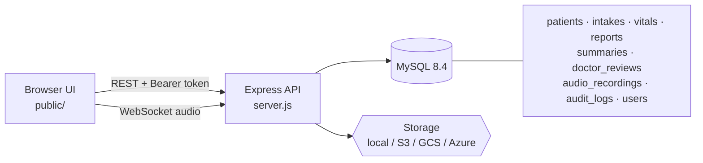

🏥 **ChikitsaKendra AI** — Smart, Secure, and Multilingual Clinical Intake Platform

- 🔒 **Zero-Trust Patient Data**: AES-256-GCM encrypted PII & SHA-256 session tokens
- 🎙️ **Real-Time Voice Streaming**: In-browser audio streaming over WebSockets
- 🩺 **Clinician Review Center**: Interactive queue with vitals, diagnostic reports & audio dossier
- 🌐 **Multilingual Ready**: Instant switching between English, Hindi, and Bengali
- 🐳 **Production Dockerized**: Full MySQL 8.4 + Node.js 22 container stack with automated tests


  # ChikitsaKendra AI

A full-stack patient intake and doctor-review platform built with **Node.js, Express and MySQL**. Patients start an anonymous session, record consent, describe symptoms, upload medical reports and send their case to a clinician review queue. Doctors sign in and work through that queue. Sensitive fields are encrypted at rest and every important action is audit-logged.

> **Status: working prototype, not a medical product.** It is not cleared for real patient data. See [Limitations](#limitations-and-roadmap) before deploying anywhere public.

---

## Features

**Patient workflow**
- Anonymous patient sessions with a per-session bearer token (only its SHA-256 hash is stored)
- Consent capture, with doctor review blocked until consent is granted
- Symptom intake and vitals (temperature, blood pressure, weight, heart rate)
- Medical report upload (PDF / JPEG / PNG, up to 10 files, 10 MB each)
- Real-time **audio recording over WebSocket** with chunked upload and storage
- Language preference saved per patient (English, Hindi, Bengali UI strings)

**Clinician workflow**
- Doctor/admin login with bcrypt-hashed passwords and JWT sessions
- Live review queue with `pending → in_review → approved / rejected` status updates

**Platform**
- Pluggable file storage: local disk, **AWS S3 (and S3-compatible)**, **Google Cloud Storage**, **Azure Blob**
- Audit trail with actor type, actor id and IP address
- Dockerized app + MySQL, schema and seed applied automatically

## Security measures

| Area | Implementation |
|---|---|
| Authentication | Staff: bcrypt + JWT (`8h` default). Patients: opaque session token, hash-only storage |
| Authorization | Role check (`doctor` / `admin`) on all `/api/doctor/*` routes; patient routes scoped to the token's own patient |
| Encryption at rest | AES-256-GCM (random IV + auth tag) on `patients.full_name` and `patients.mobile` |
| Brute-force protection | Login rate limit + account lock for 15 min after 5 failed attempts; constant-time dummy hash for unknown users |
| Input validation | `express-validator` on write endpoints |
| Transport/headers | `helmet`, CORS origin allow-list, general API rate limiter |
| CSRF | Token is sent in the `Authorization` header, never a cookie |
| Startup checks | Server refuses to start with placeholder `JWT_SECRET` / `ENCRYPTION_KEY` |
| Auditability | `audit_logs` table written for logins, intake, consent, uploads, reviews, audio |
| Retention | `retention_policy` table + `scripts/retention-cleanup.js` (manual / cron) |

Encryption is **application-level, at rest**. The server can still decrypt the data, so this is not end-to-end encryption.

## Architecture



## Project structure

```
server.js              Express app, REST routes, WebSocket audio server
db.js                  MySQL connection pool
lib/crypto-util.js     AES-256-GCM helpers + SHA-256 token hashing
lib/storage-util.js    Local / S3 / GCS / Azure storage adapter
middleware/auth.js     Staff JWT, role and patient-session middleware
middleware/validate.js express-validator error handler
database/schema.sql    Tables, foreign keys, indexes, retention defaults
database/seed.sql      Minimal seed (one PII-free demo patient)
scripts/               create-user, seed-demo-data, retention-cleanup
public/                Frontend (dashboard.html, app.js, i18n.js)
tests/                 Full end-to-end test suite (test-everything.js, test-websocket.js)
docs/                  Project report, slide outline, viva Q&A, images
```

## Getting started

**Requirements:** Docker Desktop, or Node.js 22+ and MySQL 8+.

### 1. Configure secrets

```bash
cp .env.example .env
node -e "console.log(require('crypto').randomBytes(48).toString('hex'))"    # -> JWT_SECRET
node -e "console.log(require('crypto').randomBytes(32).toString('base64'))" # -> ENCRYPTION_KEY
```

Put the output in `.env`. Use a fresh pair per environment and never commit `.env`. If `ENCRYPTION_KEY` is lost, all encrypted names and phone numbers become unreadable, so back it up separately from the database.

### 2a. Run with Docker

```bash
docker compose up --build
docker compose exec app node scripts/create-user.js drpriya "a-strong-password" doctor "Dr. Priya Sharma"
# optional demo data
docker compose exec app node scripts/seed-demo-data.js
```

### 2b. Run manually

```bash
mysql -u root -p < database/schema.sql
npm install
node scripts/create-user.js drpriya "a-strong-password" doctor "Dr. Priya Sharma"
npm start
```

Open <http://localhost:3000>. Patients can use the app straight away; open the **Doctor** tab and sign in with the account you created to see the queue.

> The default passwords in `docker-compose.yml` and `.env.example` are placeholders for local development. Change them, and do not publish MySQL port 3306, before any shared deployment.

## Configuration

| Variable | Purpose | Default |
|---|---|---|
| `PORT` | HTTP port | `3000` |
| `DB_HOST` `DB_PORT` `DB_NAME` `DB_USER` `DB_PASSWORD` | MySQL connection | `127.0.0.1` / `3306` / `chikitsakendra` / `chikitsa_app` / — |
| `JWT_SECRET` | Signs staff tokens (required) | — |
| `JWT_EXPIRES_IN` | Staff token lifetime | `8h` |
| `ENCRYPTION_KEY` | 32-byte base64 AES key (required) | — |
| `CORS_ALLOWED_ORIGINS` | Comma-separated origin allow-list | — |
| `RATE_LIMIT_WINDOW_MS` `RATE_LIMIT_MAX` `LOGIN_RATE_LIMIT_MAX` | Rate limiting | `15 min` / `300` / `10` |
| `UPLOAD_DIR` | Local upload directory | `./uploads` |
| `STORAGE_TYPE` | `local`, `s3`, `gcs` or `azure` | `local` |
| `REPORT_BUCKET` `AUDIO_BUCKET` | Bucket / container names | `reports` / `audio` |
| `AWS_REGION` `AWS_ACCESS_KEY_ID` `AWS_SECRET_ACCESS_KEY` `AWS_ENDPOINT` | S3 / MinIO | — |
| `GCS_KEY_FILE` `GCS_PROJECT_ID` | Google Cloud Storage | — |
| `AZURE_STORAGE_CONNECTION_STRING` | Azure Blob | — |

## API reference

Auth is `Authorization: Bearer <token>`. A **patient token** comes from `POST /api/patients/anonymous`; a **staff token** comes from `POST /api/auth/login`.

| Endpoint | Auth |
|---|---|
| `GET /api/health` | none |
| `GET /api/dashboard/stats` | none (aggregate counts only) |
| `POST /api/auth/login` | none, rate-limited, lockout after 5 failures |
| `GET /api/auth/me` | staff |
| `POST /api/patients/anonymous` | none, returns `sessionToken` and `wsToken` |
| `GET` / `PATCH /api/patients/:patientId` | patient (own record) |
| `POST /api/patients/:patientId/consent` | patient |
| `POST /api/intakes` | patient |
| `POST /api/intakes/:intakeId/vitals` | patient (via intake ownership) |
| `POST /api/intakes/:intakeId/doctor-review` | patient, requires granted consent |
| `POST /api/patients/:patientId/reports` | patient, multipart field `reports` |
| `GET /api/patients/:patientId/reports/:reportId/download` | patient |
| `GET /api/patients/:patientId/records` | patient |
| `GET /api/patients/:patientId/ws-token` | patient, issues a fresh WebSocket token |
| `GET /api/patients/:patientId/audio` | patient |
| `GET /api/patients/:patientId/audio/:audioId/play` | patient |
| `GET /api/doctor/reviews` | staff (`doctor` / `admin`) |
| `GET /api/doctor/reviews/:reviewId/details` | staff (`doctor` / `admin`) |
| `GET /api/doctor/reports/:reportId/download` | staff (`doctor` / `admin`) |
| `GET /api/doctor/audio/:audioId/play` | staff (`doctor` / `admin`) |
| `PATCH /api/doctor/reviews/:reviewId` | staff (`doctor` / `admin`) |

### Testing

Run the full end-to-end automated test suite:

```bash
npm test          # Runs 45 comprehensive end-to-end integration tests
npm run test:ws   # Tests WebSocket token acquisition and ping-pong handshake
```

### WebSocket audio protocol

Connect to `ws://<host>:<port>?token=<wsToken>`. Messages are JSON `{ "type": ..., "payload": ... }`.

| Client → server | Payload | Server reply |
|---|---|---|
| `audio-start` | `{ sessionId?, metadata? }` | `audio-started` |
| `audio-chunk` | `{ chunk (base64), sequence, timestamp }` | none |
| `audio-end` | `{ finalize, format, duration }` | `audio-completed` with `recordingId` |
| `ping` | — | `pong` |

Chunks are buffered, flushed to temporary files, assembled on `audio-end`, stored through the configured storage backend and recorded in `audio_recordings`.

## Database

`database/schema.sql` defines the relational model: `patients → intakes → vitals / summaries / doctor_reviews`, with `reports`, `audio_recordings` and `audit_logs` linked to the patient lifecycle, plus `users` (staff) and `retention_policy`. Foreign keys cascade on patient deletion. Developed against MySQL 8.4; the core API flow was also exercised on MariaDB 10.11.

## Limitations and roadmap

This is an engineering prototype. Be aware of the following before relying on it:

- **AI Roadmap:** The summary table has `ai_status` and `confidence` columns. The browser's speech recognition and multilingual voice input are integrated into the symptom intake, while clinician-gated LLM diagnosis summaries and OCR for reports are planned for future iterations.
- **Audio pipeline:** Browser audio is captured via `MediaRecorder` and streamed real-time over WebSocket, chunked and assembled into persistent storage with playback support in patient records and clinician review. Transcoding and per-session size caps can be added for high-scale environments.
- **Sessions:** Patient tokens are securely hashed with SHA-256 and PII is encrypted with AES-256-GCM. WebSocket authentication uses ephemeral memory tokens.
- **Content-Security-Policy:** CSP is disabled while inline dashboard components are tuned.
- **Compliance:** Retention policy tables and cleanup scripts are provided. Full DPDP Act / HIPAA audits should be conducted before production clinical deployment.

### Completed End-to-End Capabilities
- [x] Complete automated test suite (`npm test`, 45 end-to-end tests)
- [x] In-browser real-time microphone audio recording & WebSocket streaming
- [x] Clinician case dossier inspection (vitals, diagnostic reports, audio recordings)
- [x] Secure local file & audio streaming with proper MIME headers
- [x] Clean, modular project structure with zero loose artifacts

## Documentation

| File | Contents |
|---|---|
| `docs/PROJECT_REPORT.md` | Project report, abstract to conclusion |
| `docs/PPT_OUTLINE.md` | 12–15 slide presentation outline |
| `docs/VIVA_QA.md` | Oral exam questions and answers |
